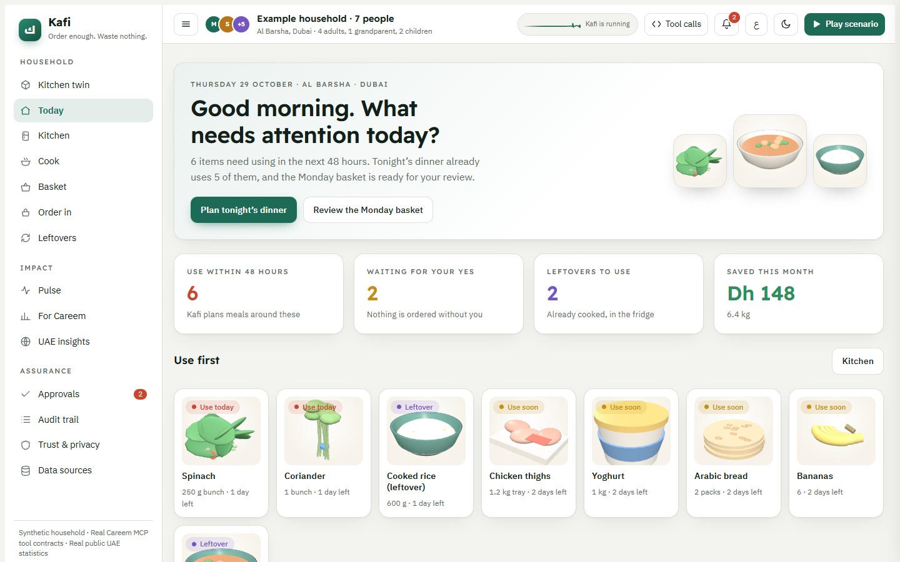
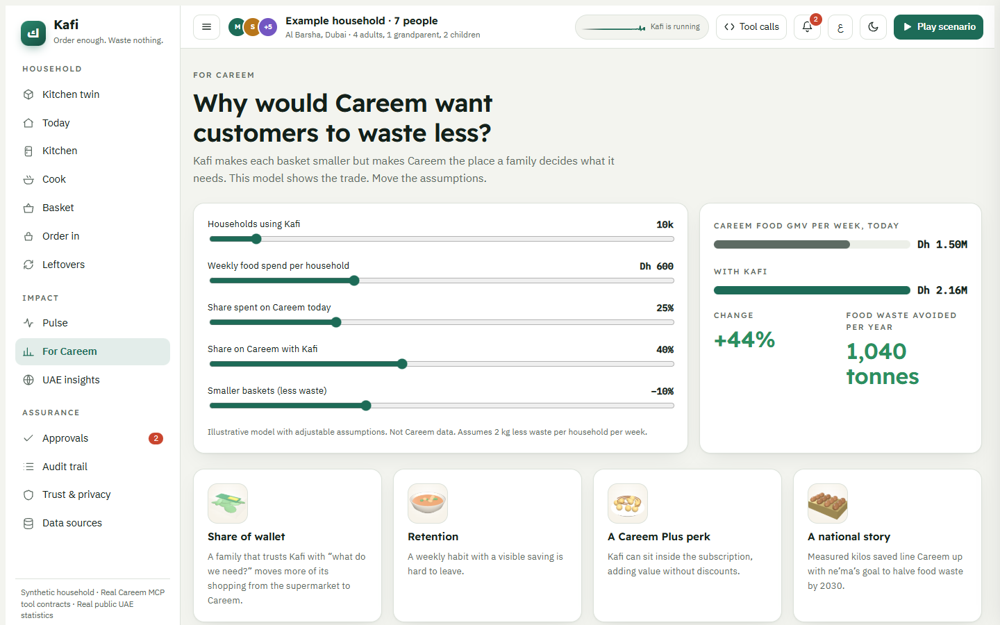
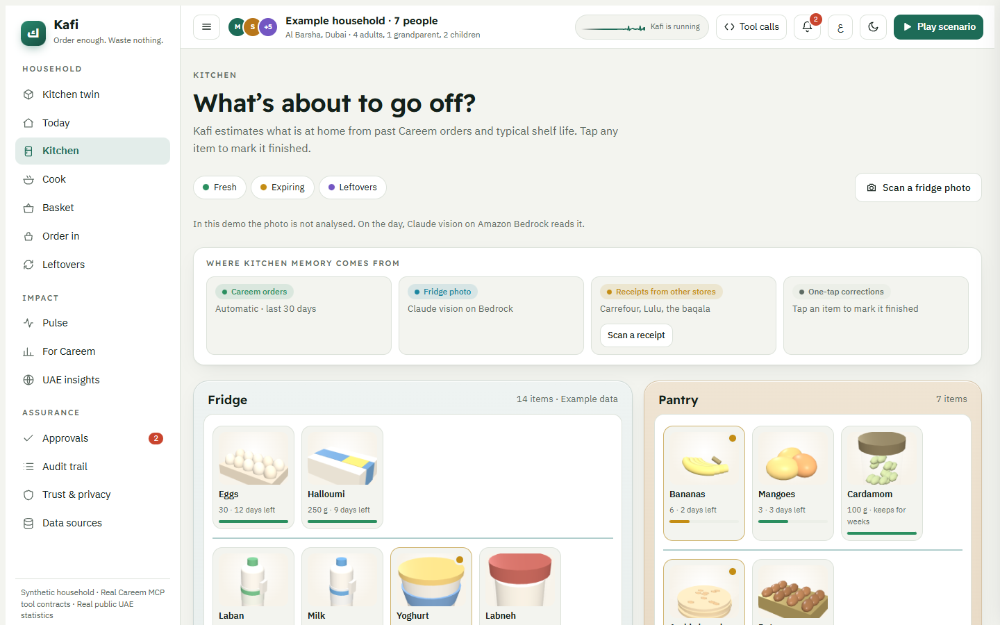
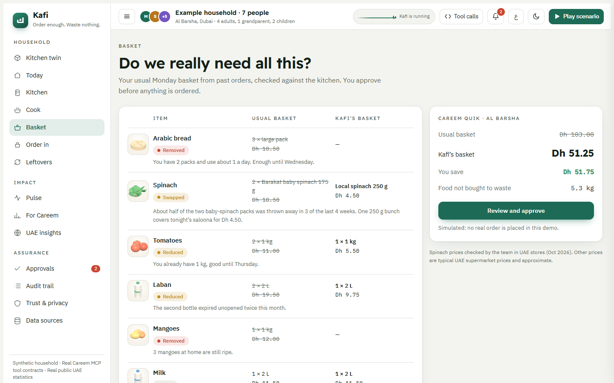
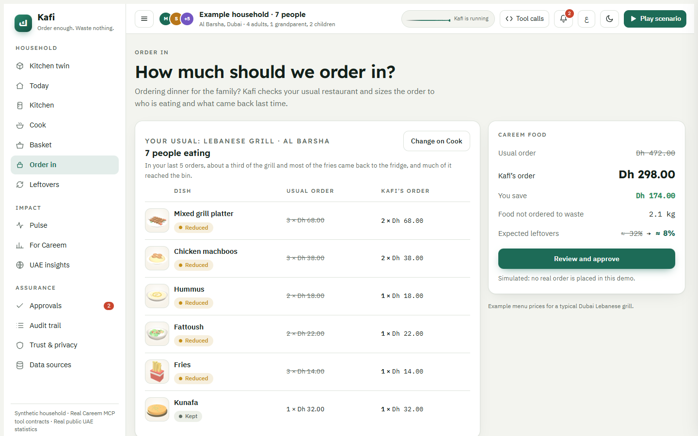
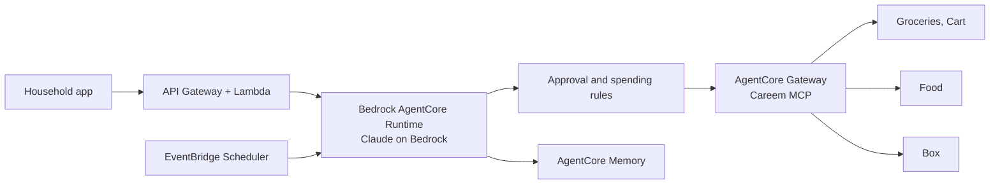

# Kafi (كافي)

Kafi is a food-waste agent for UAE households, built on Careem MCP. It keeps track of what's already in the kitchen, trims grocery baskets and restaurant orders to what the family will actually eat, and suggests meals that use up food before it goes off. Nothing is ordered without the household's approval.

Our entry for Careem Builders '26.

**Live demo:** https://qareenahqureshi-commits.github.io/Kafi/



## Why we built it

A lot of food bought in UAE homes ends up in the bin.

- About 40% of UAE residents say they often over-order food ([ne'ma, *How the UAE Eats*](https://motivatevalmorgan.com/wp-content/uploads/2025/01/nema-How-the-UAE-Eats.pdf), 6,000+ respondents).
- Around 40% of food in the UAE is wasted, worth about Dh 6 billion a year ([The National](https://www.thenationalnews.com/climate/cop28/2023/12/12/uae-residents-love-for-takeaway-food-is-creating-a-food-waste-problem/)).
- Bread, vegetables and fruit are the items people throw away most at home (ne'ma).
- Dubai Carbon estimated in 2016 that 38% of prepared food in Dubai is wasted daily, and close to 60% in Ramadan ([source](https://www.emirates247.com/news/emirates/shocking-38-of-food-prepared-every-day-is-wasted-says-dubai-carbon-2016-06-30-1.634600)).
- The UAE's target is to halve food loss and waste by 2030 ([ne'ma](https://www.arabnews.pk/node/2592882)).

Delivery apps make it very easy to order. None of them help you order the right amount.

## Features

| Feature | Careem MCP tools |
|---|---|
| Kitchen memory from past Careem orders, fridge photos and receipts from other shops | `get_activities`, `user_info` |
| Weekly grocery basket with items you already have removed and smaller packs where they fit | `search_groceries_items`, `create_grocery_cart_with_quantities`, `cart_get_basket_price`, `cart_checkout` |
| Cooking amounts for the people eating, adjusted by how much was left last time | |
| Restaurant orders sized to the family | `food_personalized_search`, `food_get_restaurant_menu`, `cart_add_items`, `cart_checkout` |
| Sending sealed extras to relatives with Careem Box | `box_get_config`, `box_get_vehicle_types`, `box_get_categories`, `box_pre_checkout`, `box_create_order` |
| Ramadan mode: iftar portions and delivery before the afternoon rush | `food_get_scheduling_slots` |
| Optional autopilot that reorders milk, eggs and bread within a weekly limit | `cart_checkout` |
| Monthly totals of food and money saved | |

Kafi follows Careem's [Agent Playbook](https://builders.careem.com/docs/agent-playbook/): it asks before any order or cart change, checks the price before checkout, doesn't switch to a pricier item when something is out of stock, doesn't retry an order after a timeout, and lets the user choose how to pay.

## What's in it for Careem

Each basket gets a bit smaller, but a family that relies on Kafi to plan its shopping is likely to move more of it from the supermarket to Careem. The **For Careem** page in the demo has a small model where you can change the assumptions (the numbers are illustrative, not Careem data).



## Screenshots







## Planned architecture



## Running it

The prototype is a single `index.html` file, so there's nothing to install.

```bash
python -m http.server 8000
```

Open http://localhost:8000, then press **Play scenario** for the walkthrough or **ع** for Arabic.

The prototype doesn't connect to a real Careem account yet. The tool names and the order they're called in come from the [Careem MCP docs](https://builders.careem.com/docs/tools/overview/), but the calls are simulated. The household, kitchen items and savings are made-up example data. Spinach prices (local 250 g for Dh 4.50, Barakat baby spinach 175 g for Dh 9.25) are from UAE shops; the other prices are rough estimates.

## Roadmap

- Connect to the Careem MCP sandbox
- Host the agent on Bedrock AgentCore
- Read fridge photos and receipts with Claude on Bedrock
- Check with Careem which Box parcel types can carry sealed food

## License

MIT
